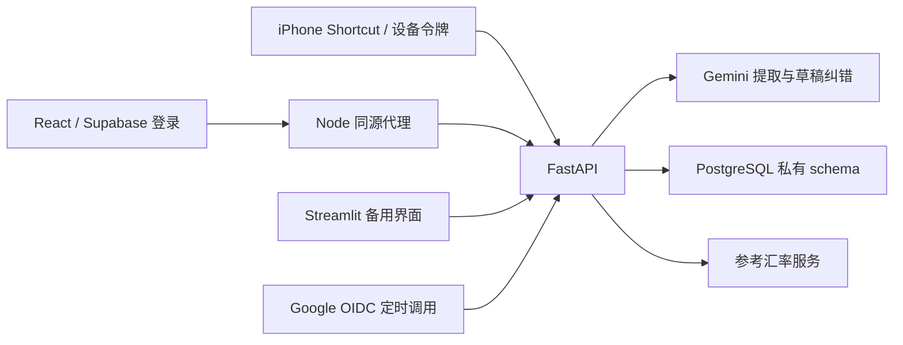

# VibeLedger

供家庭成员共同使用的支出与财富记录工具。消费截图由 Gemini 提取，网页处理日常记账、账单导入、账户余额和投资收益。

用户确认项目已实际上线使用。本说明依据仓库实现；当前线上镜像、数据库、权限和定时任务配置仍须以实际部署为准，不能从旧 staging / cutover 记录推定。

## 功能

| 网页入口 | 当前功能 |
| --- | --- |
| 总览 | 本月支出分类、最近交易、财富覆盖、余额更新提醒、待处理数量 |
| 日常支出 | 筛选与分页、手动消费／退款／收入、修改与作废、循环／分期月度计划 |
| 家庭财富 | 手动或截图更新余额、纠错与作废、历史财富、资产风险分布、投资区间投入／取出确认 |
| 待处理 | 识别草稿、已保存交易补资料、计划重复候选、异常投资估算 |
| 账单导入 | 为选定账户上传 PDF，审核交易、处理重复、整单提交，可独立选择期末余额 |
| 设置 | 账户范围／别名／生命周期、分类、投资提醒阈值、当前用户的设备凭据 |

iPhone Shortcut 用于消费截图；清晰证据可直接保存，不确定证据进入草稿。实际导出文件的行为和限制见 [Shortcut 核对](docs/architecture/SHORTCUT_COMPATIBILITY_BOUNDARY.md)。

## 架构与数据流



- `ai-ledger-web/`：React、TypeScript、Vite；`server.mjs` 提供静态页面、公开 `/config` 与固定目标的 `/api/v1/*` 代理。网页直接向 Supabase Auth 登录，财务数据全部经过 FastAPI。
- `ai-ledger-backend/app/`：路由负责协议与认证，services 编排回执和事务，domain 验证业务，repositories 访问 PostgreSQL。Gemini 仅返回候选事实，不能决定权限或直接入账。
- PostgreSQL：16 张应用表加 `schema_migrations`，覆盖身份与配置、支出、余额观察、投资区间输入、月度计划、账单证据、汇率、持久回执与追加式审计。
- `ai-ledger-dashboard/`：保留的 Streamlit REST 客户端，没有财务数据库直连；不是 React 的启动入口。

截图／PDF 请求先保留幂等回执，释放数据库连接后识别，再重新检查身份、版本和引用。明确证据按规则提交，否则保存草稿。确认时，财务记录、证据关联、审计和终态回执在同一事务完成。网络结果未知时按原键恢复，不能直接换键重发。

## 关键业务规则

1. **支出与余额是两套独立事实。** 消费不会扣账户余额；余额更新不会生成消费、收入、转账或校准交易。没有推算余额、银行流水对账或信用卡结算分录。
2. **未知不等于零。** 财富取每个账户截至指定时刻的最后有效观察；缺余额或汇率时仅展示已知小计，完整总额为 `null`。旧余额仍计入已知金额，并显示日期与陈旧提醒。
3. 账户范围必须不重叠。负债用负余额，信用卡需要全部欠款而非本月账单／信用额度；溢缴款为正资产。风险分布只以正资产为分母。
4. 消费、退款、现金收入均保存正原币金额；净支出为消费减退款，退款在收到日抵减。转账与还款不计支出。收入独立展示，不据此计算储蓄率。
5. 投资区间收益 = 期末余额 − 期初余额 − 投入 + 取出。未确认完整外部资金流时按零估算，必须标为估算；明确确认零也属于确认。收益不会生成收入记录。
6. 金额使用 PostgreSQL NUMERIC、Python Decimal、JSON 十进制字符串；币种和小数位严格校验。业务日期和计划到期按家庭时区处理，账户日期边界的现有差异见详细约束。
7. 持久幂等、版本检查、家庭隔离、整单原子提交、不可修改的审计是数据一致性的核心。作废／替换保留历史，不能硬删记录来“修复”财务数据。

确认、去重、余额范围、收益配对和时效规则见 [业务约束](docs/architecture/CONTRACTS.md)。API 字段以 [生成的 OpenAPI](docs/api/openapi.json) 和路由实现为准，不维护第二份手写字段表。

## 本地运行

基准环境：Python 3.13、Node 24（最低 22.12）、PostgreSQL 17。后端固定依赖在 `requirements.txt`，网页使用 `package-lock.json`。

在 `ai-ledger-backend/` 创建并激活虚拟环境，然后安装、启动：

```sh
python -m venv .venv
# 激活 .venv 后执行：
python -m pip install -r requirements.txt
uvicorn app.main:app --host 127.0.0.1 --port 8000
```

通过环境变量或该目录的私有 `.env` 配置 `ENVIRONMENT=development`、本地 `DATABASE_URL`、独立 `DB_SCHEMA` 和认证；识别需要 `GEMINI_API_KEY`，默认模型为 `gemini-3.5-flash-lite`。示例 `.env.example` 的阶段注释／HMAC 配置不能直接作为生产配置。

仅对明确的本地开发数据库，用 operator 凭据初始化：

```sh
python -m migrations.runner
python scripts/bootstrap_simplified.py --owner-auth-subject <verified-auth-subject> --owner-email <email>
```

bootstrap 创建示例账户和分类，不创建余额或交易；默认家庭起始日为 2026-01-01，适合测试种子。真实家庭须先确定起始日／币种／时区与身份映射，登录不会自动建立用户或成员关系。迁移 runner 拒绝 `production`，不能通过改环境标签绕过。

网页在 `ai-ledger-web/` 运行：

```sh
npm ci
npm run dev
```

Node 进程需显式配置 `BACKEND_URL=http://127.0.0.1:8000`、`SUPABASE_URL`、`SUPABASE_PUBLISHABLE_KEY`（仅 `sb_publishable_...`）及与家庭一致的 `DASHBOARD_TIMEZONE`。本地默认监听 `127.0.0.1:3000`，容器通过环境改为 `0.0.0.0:8080`；Node 不自动加载后端 `.env`。生产模式先 `npm run build` 再 `npm start`。

备用 Streamlit：在 `ai-ledger-dashboard/` 安装其 `requirements.txt`，使用同一组前端参数执行 `streamlit run app.py`。认证和命令恢复状态保存在服务端会话中，与 React 的浏览器持久登录不同。

## 测试与部署

测试入口、隔离数据库要求和开发约束见 [AGENTS.md](AGENTS.md)。CI 覆盖后端单元／PostgreSQL／迁移／并发、Streamlit、React／浏览器及容器；mock 通过不代表真实 Gemini、iPhone 或线上配置已验证。

各应用有独立 Dockerfile；后端容器监听 7860，网页监听 8080。FastAPI 启动不执行 DDL。`/health` 只证明进程可用，`/ready` 检查数据库 lineage／checksum 和 Gemini 密钥是否配置，不执行真实识别。无 Gemini 时仍可启动并以 degraded 状态提供手动功能。

部署参数、Supabase JWKS、数据库权限、定时计划与回滚边界见 [运维说明](docs/deployment/S6_PRODUCTION_CUTOVER.md)。该文件保留旧名称以维持 SQL 引用，内容已改为持续运维说明。部署或生产写入依据该次任务授权。

## 文档入口

- [AGENTS.md](AGENTS.md)：新的 Codex 会话先读的开发指令。
- [业务约束](docs/architecture/CONTRACTS.md)：财务语义与事务边界。
- [Shortcut 核对](docs/architecture/SHORTCUT_COMPATIBILITY_BOUNDARY.md)：实际动作与协议、设备端限制。
- [运维说明](docs/deployment/S6_PRODUCTION_CUTOVER.md)：配置、初始化、持续运行与恢复。
- [真实 Gemini 诊断](docs/testing/EXPENSE_GEMINI_LIVE_SMOKE.md)：显式选择的无账本写入检查。

`ai-ledger-dashboard/README.md` 仅额外保留平台部署元数据；OpenAPI、operator SQL 和已有截图保留。未被测试使用且含旧结算字段／错误手机行为的手写协议 JSON 已移除，以生成契约和运行测试为准。

阶段计划和旧验收细节保存在 Git 历史，不作为当前上线状态或未来开发待办。
